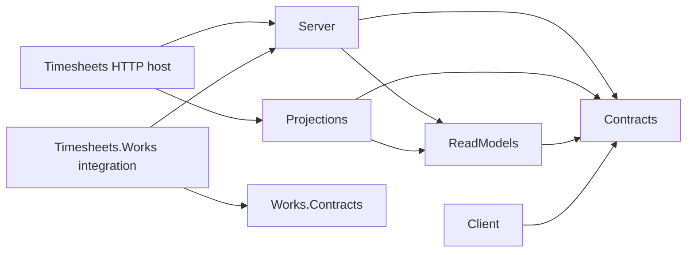

# Hexalith.Timesheets architecture

Timesheets records effort against one Project or Work item, attributes it to a Party, and preserves the approval and correction history that finance can reconcile. The module uses event sourcing and CQRS. Commands commit facts to the tenant-scoped owner stream. Queries read rebuildable projections. Operational views, the Approved-Time Ledger and CSV each have a different disclosure boundary.

**Release remains FAIL.** The v2.1.1 audit found that the production Project journey, workload confirmation and finance delivery still need implementation and deployed evidence. The adopted decisions below specify the behavior that work must deliver. The release owner records acceptance in the launch register. [November 20 audit](sprint-change-proposal-2026-11-20.md) · [Launch register](../../docs/launch-readiness.md)

## Core Architectural Decisions

### AD-1 — Give each fact one owner [ADOPTED]

- **Binds** command handlers, event contracts, projections and integrations (FR-1–3, FR-12, FR-21, FR-23).
- **Prevents** conflicting copies of a contributor, target, or approved entry from becoming authoritative.
- **Rule** Timesheets owns entry evidence, the Billable Flag, period review, Activity Types, confirmation, corrections and export audit. Tenants owns membership, Parties owns identity, Projects owns project state, and Works owns work lifecycle and estimates. Persist their stable IDs only. Hydrate permitted display data at read time. Keep aggregate decisions and event application pure. Services perform I/O and commit domain events through EventStore. During normal delivery, the registered projection handler writes its read model through the SDK. Certified index migrations and shared rebuilds use the SDK’s fenced recovery paths and preserve prior evidence. [Index migration and rebuild](../implementation-artifacts/tests/five-magic-link-consistency-deferrals.md)

### AD-2 — Resolve authority at the operation boundary [ADOPTED]

- **Binds** draft capture, submission, approval, query, export and capability operations (FR-2, FR-9, FR-12–14, FR-16).
- **Prevents** a claim, a stale label or a lower-priority provider from authorizing a protected action.
- **Rule** Derive request context from authenticated sources. Gate tenant and resource access before loading protected state, dispatching a command or disclosing a result. Validate the contributor and exactly one target for draft capture. Submission and approval revalidate required authority. Only display hydration may tolerate staleness after the target check succeeds. For entry and period review, use the highest-precedence applicable provider group. A contradiction or unavailable deciding group denies the action. Self-approval requires explicit action-specific permission. [Approval policy](../../src/Hexalith.Timesheets.Server/ApprovalAuthority/TimesheetsApprovalAuthorityPolicyOptions.cs)

### AD-3 — Preserve entry and period decisions independently [ADOPTED]

- **Binds** contributors, approvers, projection builders and finance consumers (FR-3–9, FR-16, FR-18).
- **Prevents** a partially written period from appearing complete and a correction from erasing earlier approved evidence.
- **Rule** An entry carries separate approval, correction and lock states. A weekly or monthly period identifies one tenant, contributor, tenant-local period key and included entry IDs. Record audit instants in UTC. Selected entries may submit partially when policy allows. If any included entry fails whole-period validation, return valid IDs and field-specific failures and emit zero submission events for that request. The period records grouped evidence. Each affected entry records its own approval or rejection linked to that period decision, while unaffected entries retain their state. Approval needs no reason. Rejection requires a nonblank reason. Lock approved entries against direct edit. Corrections append superseding evidence with actor, time and lineage. A corrected approved entry still matches an Approved filter. A contributor can correct and resubmit a rejected entry independently while retaining the period’s decision and rejection history. [State vocabulary](../../src/Hexalith.Timesheets.Contracts/ValueObjects/TimesheetsEnums.cs) · [PRD §5.2](prds/prd-timesheets-2026-06-18/prd.md#52-submission-approval-rejection-and-locking)
- **Admitting a new approval or rejection** Require a fresh summary for the period and for every included entry, including members outside a selected rejection. Compare the summaries with the period owner’s membership. A missing member, incomplete evidence, or a stale summary blocks the new decision. The coordinator checks reported freshness and incomplete IDs. It also needs to verify the full roster. [Review coordinator](../../src/Hexalith.Timesheets.Server/TimesheetPeriods/TimesheetPeriodApprovalCommandService.cs)
- **Completion across streams** Use the tenant and period ID to identify a submission. Use the tenant, period ID and approval decision ID to identify a review. Before the first owner effect, persist enough evidence in EventStore to recover the admitted operation. Bind its contributor, actor, action, period boundary, member IDs, rejection reason and per-entry rejection details. Retain the original UTC instant, authority attribution and expected owner effects for replay. Compare member IDs as a set and rejection details by entry ID. A reordered retry is equivalent. Reuse of an identity for a different intent is a conflict. For submission, distinguish members already submitted at validation from entries that need a new transition. For rejection, only selected entries change.
- **Retry and acknowledgement** Authorize access to the admitted operation and recover its recorded intent from the period and entry streams, including after restart or a period no-op. A transition already applied remains verifiable even as entry state or projection freshness changes. Resume only outstanding effects under the owner’s concurrency check. Conflicting evidence blocks completion. Until the period decision and every required entry effect match durable evidence, keep the operation pending for callers, readers reporting whole-period completion and actions that require it. Views may show verified individual entry states. The coordinator returns separate domain results. Qualify the persistence path by interrupting a two-entry submission between writes, restarting and retrying. Verify one period decision and exactly one of each required transition. [Submission coordinator](../../src/Hexalith.Timesheets.Server/TimesheetPeriods/TimesheetPeriodSubmissionCommandService.cs)

### AD-4 — Apply catalog rules at selection time [ADOPTED]

- **Binds** catalog administration, capture, capability processing and historical readers (FR-10–11, FR-14).
- **Prevents** readers from merging types by label or invalidating an earlier confirmation when a catalog changes.
- **Rule** Identify types by ID and tenant or Project scope. Ordinary Project capture can select active tenant types plus active types for the selected Project, narrowed by explicit Project restrictions. Project catalog writes and restrictions require tenant and Project authority. For magic-link issuance or adjustment, use an active, selectable **tenant-owned** type with fresh scoped catalog evidence. At processing time, require a complete tenant-bound snapshot covering the relevant restrictions. Only a verified absence of restrictions permits unrestricted selection. The snapshot can precede a concurrent catalog change. Apply Project restrictions only to a Project target. An otherwise valid link can display and confirm its recorded tenant type after deactivation or exclusion. Preserve historical identities when types are renamed or deactivated. [PRD §5.3](prds/prd-timesheets-2026-06-18/prd.md#53-activity-type-catalogs)

### AD-5 — Confirm the recorded contribution exactly once [ADOPTED]

- **Binds** the external workload API, magic-link endpoints, owner command handlers and operators (FR-13–14).
- **Prevents** an accepted HTTP response without a recorded effect, a retry that adds a second effect, or a link that grants browsing rights.
- **Rule** On the workload path, authorize the caller, load the recorded entry in its tenant, check contributor and target, commit through the owner and verify the exact effect before acknowledgement. Preserve approval state. Bound verification by a configured deadline and caller cancellation. A retry with the same command identity, including after restart, resolves to one matching effect. Return opaque refusals to other tenants or contributors. Distinguish policy refusal from indeterminate commit in low-cardinality operator outcomes.
- **Capability path** Bind an opaque token to one tenant, contributor, entry, allowed action and expiry. Store only its hash and safe capability metadata. The capability-ID stream owns issuance. The index locates a candidate. Verify scope, freshness and single-use status by reading issuance and the target Time Entry’s history in the same tenant. For a proposed Time Entry, an authoritative `MissingStream` response for that target means empty owner history before first use. Other missing or unreadable owner evidence denies use. Honor a supported legacy terminal event on the capability stream. Multiple terminal transitions across the two streams or conflicting identity evidence deny use. The Time Entry stream owns new use, revocation and expiry. Its owner rechecks persisted terminal history, serializes competing transitions and commits consumption with its contribution effect in one decision. Invalid, expired, revoked and used links share the same public refusal. Disclose a comment only under explicit external-display policy with the required redaction. Acknowledge a mutation only after completed command status and exact event readback. [Capability state loader](../../src/Hexalith.Timesheets.Server/MagicLinks/EventStoreMagicLinkConfirmationCapabilityStateLoader.cs) · [Host endpoints](../../src/Hexalith.Timesheets/Endpoints) · [Capability consistency decisions](../implementation-artifacts/tests/five-magic-link-consistency-deferrals.md)

### AD-6 — Rebuild reports from attributable evidence [ADOPTED]

- **Binds** projections, operational reports, dashboards, the Approved-Time Ledger and the Works adapter (FR-15–18, FR-20–21).
- **Prevents** replay duplicates, double-counted corrections, and comparisons between incompatible units.
- **Rule** Scope replay to tenant and owner stream. Validate sequence and duplicate delivery, preserve canonical order and expose projection freshness. The ledger contains approved billable and non-billable evidence. A ledger row identifies its entry, contributor, target, approval and correction lineage. Distinguish current from superseded rows and retain both when requested. Report human/external duration in whole minutes. Report AI wall-clock time, model/tool runtime, billable effort and tokens independently. Missing provider counts stay unknown and a reported zero stays zero.
- **Works comparison** Use the authorized estimate and unit from the Works query contract. Timesheets derives actuals from its own entries. Compute variance only from a fresh supplied estimate and comparable actuals in compatible units. Preserve the Works outcome when no comparison is possible. `NotSupplied` means an authorized lookup found no usable estimate or unit, `Unavailable` means the source could not be read, `Unauthorized` withholds protected plan values, and `Stale` carries explicit stale source evidence. Suppress variance in all four cases and return independently authorized actuals with their own freshness. The current Works view supplies a sequence alone, which cannot establish staleness. Platform must supply an `IWorksQueryChannel` and opt into validation and planned-effort reporting separately. The default host denies Work capture and reports the plan unavailable. [Planned-effort adapter](../../src/Hexalith.Timesheets.Works/WorksQueryWorkPlannedEffortProvider.cs) · [Works boundary and activation](../../docs/boundary-decision-record.md#current-scaffold-note)

### AD-7 — Release finance output only after snapshot and receipt verification [ADOPTED]

- **Binds** direct ledger queries, export preview, CSV generation, audit recording and downstream finance (FR-18–19).
- **Prevents** sensitive text leaking through correction history and delivery of partial, mixed-version or unaudited evidence.
- **Rule** Apply the following contract to every representation, including nested original and corrected values. A missing required export policy blocks the operation. Preview and generation both require the CSV v1 billable-only filter, fresh evidence on every page, and a nonempty eligible scope to report readiness. Preserve permitted IDs and lineage when omitting text.

| Boundary | Required evidence and response |
| --- | --- |
| Direct ledger read | Authorize the result. Publish a comment only when the host has both `CommentSensitivityPolicyConfigured` and `ProjectionCommentsAllowed` enabled and that value carries a supported server-issued `ServerPublicationVersion` (currently 1 or 2) with `ServerProjectionInclusion = Allowed`. Apply this to current, original and corrected values independently on direct reads and rebuild. Omit text for missing, zero, unknown or denied authority. Caller-supplied `ProjectionInclusion` cannot grant publication. |
| Preview | Evaluate the trusted tenant policy and each applicable comment value across the full authorized scope. Return readiness, freshness, row count and the v1 scope summary below. Preview returns metadata only and creates no file or audit event. |
| Generation | Require both trusted tenant and per-value export permission for text, including each historical value. An export allowance cannot restore text withheld at publication. Start at the first page of the authorized filter scope or explicitly reject a partial request. Read one identifiable ledger version in deterministic order. Include every matching current or requested superseded row exactly once. Traverse an empty authorized page when its continuation advances. A wholly empty scope blocks delivery. If scope, disclosure, version, progress or completeness cannot be verified, withhold all bytes and rows. |
| Delivery and retry | Hash the final deterministic CSV bytes with SHA-256 and read back one durable EventStore receipt matching the stable request identity, requester, tenant, filters, count, format version and hash. Record UTC request and generation instants, correlation, output scope and freshness. Keep comments and row bodies out of the receipt. Rejection or an uncertain commit releases zero bytes and rows. After a lost acknowledgement or restart, the same request must recover its matching receipt. Reusing an identity for different scope or content fails closed. |

**V1 preview policy.** Summarize only populated, publication-authorized current and historical comment values in the authorized ledger. Skip absent or publication-withheld text without reloading it. Count a published value denied export as excluded. On a ready scope, `CommentExportPolicy` is `Allowed` only when at least one such value exists and every value permits export. A tenant exclusion, no comment values, or no permitted values yields `Excluded`. For mixed permissions return `Excluded` with the `ReadinessDetail` sentence “Comments are permitted for some values only.” This distinguishes mixed scope from complete exclusion using the existing response fields. Mixed permission alone leaves the export ready. Generation evaluates every value again. If the access gate denies disclosure, return the opaque denial with no preview. If an authorized evaluation lacks a required export policy, return a blocked preview with `PolicyRequired`. Neither case permits generation.

**Qualification.** Compare direct and rebuilt ledger rows with host publication on and off, legacy or unsupported policy versions, and old and corrected values carrying opposite decisions. Verify the preview summary and generated bytes for all-allowed, all-excluded and mixed scopes. The v2.1.1 ledger mapper consulted `ProjectionInclusion`, and its preview reported only the host export flag. The [local finance qualification](../implementation-artifacts/spec-finance-export-local-deferrals.md) covers both boundaries. [Ledger mapper](../../src/Hexalith.Timesheets.Contracts/Models/ApprovedTimeLedgerRowReadModel.cs) · [Evidence publication policy](../../src/Hexalith.Timesheets.Projections/TimeEntries/TimeEntryEvidenceCommentPolicy.cs)

Finance consumers own rates, invoices, payroll and financial calculations. Finance delivery requires passing every acceptance criterion in Stories 6.1–6.3. The v2.1.1 audit reproduced mixed-checkpoint output and delivery following rejection. The default recorder now withholds acknowledgement. Production delivery still requires a durable receipt implementation. [Export service](../../src/Hexalith.Timesheets.Server/Exports/ApprovedTimeExportService.cs) · [Default recorder](../../src/Hexalith.Timesheets.Server/Exports/DomainEventApprovedTimeExportAuditRecorder.cs) · [Preview contract](../../src/Hexalith.Timesheets.Contracts/Models/ApprovedTimeExportPreviewReadModel.cs)

### AD-8 — Enroll only receivers installed by the host [ADOPTED]

- **Binds** Server, Projections, ReadModels, package consumers, the HTTP host and FrontComposer (FR-21–23).
- **Prevents** standalone package discovery from requiring an undeclared assembly or a composed host from enrolling a route twice.
- **Rule** Contracts owns public DTOs, scope identities and metadata. ReadModels owns shared SDK index helpers and stored wrappers. Server and Projections consume it independently. Preserve public CLR identities, type forwarding and stored JSON shapes. Keep the canonical tenant catalog address and its single projection writer. A Projections-only consumer must enumerate its supported inventory from declared dependencies. The composition that installs both assemblies must enroll every installed command and named projection exactly once, including operation schemas and receiver methods. Version or migrate the existing public combined members and discovery attribute when moving ownership. [Shared read-model ownership](../../docs/boundary-decision-record.md#shared-read-model-ownership--2026-10-25) · [Projection inventory](../../src/Hexalith.Timesheets.Projections/TimesheetsProjectionRouteCatalogDeclarations.cs)

### AD-9 — Put release bindings and qualification in the owning composition [ADOPTED]

- **Binds** Timesheets, Platform, EventStore, the release owner and consumer hosts (Epic 6, FR-14, FR-22).
- **Prevents** a permissive reusable kernel or a Development fixture from standing in for a deployed Project workflow.
- **Rule** Retain the existing HTTP host, AppHost and ServiceDefaults. Keep the reusable authorization, required policy and reader defaults closed. The release composition supplies trusted tenant, Party, Project, activity, approver, evidence-policy and ledger providers. Enroll capture, submission, approval and additive correction through supported entry points. Qualify that workflow with one authorized tenant and verify a second tenant cannot read or change the entry. After restart and again after rebuilding from owner events, compare ledger row IDs, effective values and correction lineage. Record the graph, environment, entry points and sanitized outcomes. [Kernel registration](../../src/Hexalith.Timesheets.Server/Runtime/ServiceCollectionExtensions.cs) · [Platform binding](../../references/Hexalith.Platform/src/Hexalith.Platform.Composition/PlatformTimesheetsBinding.cs)

## Qualification of the Project and finance workflows

The November 20 backlog assigns implementation and acceptance separately. The four currently declared commands cover recording and magic-link operations. The host registers both owner assemblies, including four named projection handlers and the concrete EventStore-backed capability loader. Platform’s inspected Timesheets binding is Development/source-only. [HTTP composition](../../src/Hexalith.Timesheets/Program.cs) · [Command inventory](../../src/Hexalith.Timesheets.Server/Runtime/TimesheetsRouteCatalogDeclarations.cs) · [Epic 6](epics.md#epic-6-qualify-project-time-and-finance-evidence)

| Work | What the implementation team must prove |
| --- | --- |
| 6.1–6.3 · Finance | Run mixed tenant/row disclosure cases, inject audit rejection or lost acknowledgement, and change a row between pages. Compare delivered bytes and receipt, or observe zero output under AD-7. |
| 6.4–6.5 · External API | Record then confirm through workload-authenticated HTTP. The current confirmation handler passes an empty owner state. Exercise bounded readback, retry and restart against EventStore under AD-5. |
| 6.6 · Package discovery | Test two clean packed consumers, Projections alone and a host with Server and Projections. The combined inventory currently loads Server by name. Compare supported routes, operations and methods against the installed receivers under AD-8. |
| 6.7–6.8 · Project | Timesheets and Platform wire the Project workflow, then the release owner runs the deployed restart, rebuild and cross-tenant checks under AD-9. |
| 6.9 · Ledger cost | Fold validated history once per owner and check golden rows and CSV bytes. Compare elapsed time and allocations at 60, 240 and 960 entries. The reporting owner sets a representative tenant volume and budget before considering separate materialization. |

## Project Structure & Boundaries

Arrows show selected direct compile-time dependencies for the domain packages. The HTTP host composes the command and projection inventories. Its registration of the EventStore SDK supplies the processing and read-model infrastructure.

### Complete Project Directory Structure

The solution manifest owns the project list. The ten source projects comprise the HTTP host, AppHost, ServiceDefaults, Contracts, Client, Server, ReadModels, Projections, Works and Testing. The six test projects are ArchitectureTests, Contracts.Tests, Server.Tests, Projections.Tests, IntegrationTests and Works.Tests. Earlier stories cite the original scaffold decision and historical package observations. [Solution](../../Hexalith.Timesheets.slnx) · [Historical architecture](https://github.com/Hexalith/Hexalith.Timesheets/blob/271442d0cad21a66be9aacb7fb0b36e28b670181/_bmad-output/planning-artifacts/architecture.md)

### Frontend Architecture

Timesheets publishes UI-neutral contracts and FrontComposer metadata. The consuming host renders Fluent UI V5 components and owns keyboard, focus, responsive behavior and WCAG 2.2 AA browser evidence. It distinguishes command acceptance from verified results, especially an export ready to download. The consumer may use V4 icons only where a V5 icon source is unavailable. The module owns no rendering project. Eligible agent-facing operations enroll through the shared Hexalith.McpCli contract and authorization process. [UX experience](ux-designs/ux-timesheets-2026-06-18/EXPERIENCE.md) · [Module boundaries](../../docs/boundary-decision-record.md)

### Workspace Dependency Ownership

Use the repository’s declared direct references. For Works source builds, preserve an explicit `HexalithWorksRoot`. When it is unset, resolve `references/Hexalith.Works` first and the sibling `../Hexalith.Works` second. Restore treats the selected checkout as read-only. Pass the evaluated `HexalithEventStoreVersion`, including an explicit caller override, through Works restore and build edges. [Source resolution](../../Directory.Build.props) · [Version forwarding](../../Directory.Build.targets)

## Stack and build modes

Timesheets commit `5873e86` records Builds `e1380b81`. The table gives the repository selections at that revision. Reproduce a release with its recorded submodule revisions and package graph.

| Name | Version | Owner or use |
| --- | --- | --- |
| .NET SDK / target | 11.0.100 / net11.0 | `global.json` allows latest patch. Microsoft.Testing.Platform runs the individual test projects. |
| Aspire AppHost SDK / CLI | 17.0.0 / 17.0.0 | Existing local AppHost requires the matching CLI bundle and `AspireUseCliBundle=true`. |
| Hexalith.EventStore | 5.4.0 | Default evaluated in both Debug/source and Release/package with the refreshed Builds catalog. Explicit consumer selection takes precedence. |
| Dapr SDK | 1.19.1 | Shared SDK package family used through EventStore. |
| Dapr self-hosted runtime / CLI | 1.19.2 / 1.19.1 | Selections in the refreshed Builds catalog. Deployed qualification records the versions actually exercised. |
| Aspire Keycloak / CommunityToolkit Dapr hosting | 17.0.0-preview.1.26567.5 / 17.0.0-beta.1052 | Timesheets retains these root package updates. |
| Fluent UI components | 5.1.0 | Shared catalog observation. Rendering and its package graph belong to the consuming host. |

Restore and build Debug with `UseHexalithProjectReferences=true` for local source work. CI restores and builds Release with published packages. In both cases use the same mode for restore and build. Timesheets imports the shared Builds catalog, applies its Aspire updates, and supplies the Works.Contracts 1.0.2 fallback only when the catalog omits that package. [SDK](../../global.json) · [Shared package catalog](../../references/Hexalith.Builds/Props/Directory.Packages.props) · [Root package policy](../../Directory.Packages.props) · [Build commands](../../README.md#build-and-test)

## Implementation Patterns & Consistency Rules

| Concern | Rule |
| --- | --- |
| Contracts and transport | Keep public DTOs independent of EventStore envelopes. Use additive event fields or new event types, stable string identifiers, camelCase JSON, ISO-8601 dates and UTC audit instants. Return typed domain outcomes and projection freshness. Use ProblemDetails for transport failures and opaque responses where disclosure would identify protected data. |
| Data protection and diagnostics | Use OpenTelemetry with safe correlation IDs and structured, low-cardinality outcomes. Exclude raw links, tokens, credentials, other secrets, personal identities, comments, command bodies, raw event payloads and export rows from logs and traces. Enforce privacy at ingress, host and sidecar. Scope protected cursors and share protected key material across replicas when continuity requires it. |
| Retention and historical reads | Retain entry, approval and correction history indefinitely by default. Tenant policy governs retention of export and capability audit metadata and authorized comment use. Missing required retention, legal-hold or comment-sensitivity configuration denies dependent commands, confirmation, export and action visibility. Tenant configuration and legal-hold approval require evidence from the owning parties. |
| Deployment and operation | Aspire orchestrates the local topology. EventStore owns domain service processing and projection infrastructure. Protect internal SDK routes on the internal listener and authenticate workloads. Use the configured JWT/OIDC authority for the deployment and keep the symmetric Development fixture isolated. Platform owns production-equivalent provider bindings and deployment configuration. Maintain authorized, tenant-bound replay and recovery. |

### Integration Points

| Capability | Owning implementation | Decisions |
| --- | --- | --- |
| Capture, submit, approve, correct and lock | Server TimeEntries and TimesheetPeriods. Contracts defines requests, states and linked decisions. | AD-1–3 |
| Activity Type catalog | Server ActivityTypes handles tenant and Project governance. Projections supplies the canonical catalog read model. | AD-2, AD-4, AD-8 |
| External workload and magic links | HTTP endpoints call Server command services. Named projection handlers supply candidate indexes and evidence. The owner decides each transition. | AD-2, AD-4–5 |
| Reports, dashboard and ledger | Projections derives rows from events. Server gates and shapes reads. Timesheets.Works provides opt-in estimates. | AD-1, AD-3, AD-6–7 |
| Finance delivery | Server Exports orchestrates the authorized ledger read, disclosure, CSV and durable receipt. | AD-6–7 |
| Public surfaces and deployment | Contracts and Client serve consumers. The HTTP host registers the installed receivers. Platform binds external authorities and the consumer host renders the UI. | AD-8–9 |

## Deferred

- **Release evidence.** Stories 3.6 and 3.7 own deployed magic-link authority, legacy inventory and continuity, shared rebuild and ingress privacy. The October 26 isolated local pass has a narrower scope. Tenant/platform and legal owners supply policy configuration and hold disposition. The product owner supplies UAT. Package currency carries **CONCERNS**. [Launch scope and owners](../../docs/launch-readiness.md#launch-scope-classification)
- **Works activation and performance.** Platform owns activation of the live query channel. Works and Platform revisit stale-state detection when the query contract supplies adequate freshness evidence. The 500 ms p95 command and 2 s p95 report targets have historical in-process measurements. The persisted wire-path waiver is revisited when realistic runtime fixtures are available. [Performance evidence](../../docs/performance-evidence.md)
- **Finance implementation choices.** The EventStore and finance owners settle receipt recovery and snapshot continuity in 6.2–6.3. Retaining a snapshot and detecting drift with a retry are both permissible if AD-7 holds. A dedicated preview HTTP route, structured API/webhook delivery and offset-entry corrections need a later consumer or finance decision. [PRD scope and decisions](prds/prd-timesheets-2026-06-18/prd.md#14-open-questions)
- **Later policy decisions.** Lower-priority approver fallback, carry-forward of prior approvals into later periods, richer comment classification and secondary identity checks for high-value links require separate owner decisions. V1 follows AD-2–5. [PRD](prds/prd-timesheets-2026-06-18/prd.md#14-open-questions)
